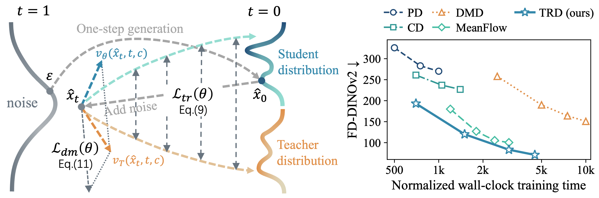
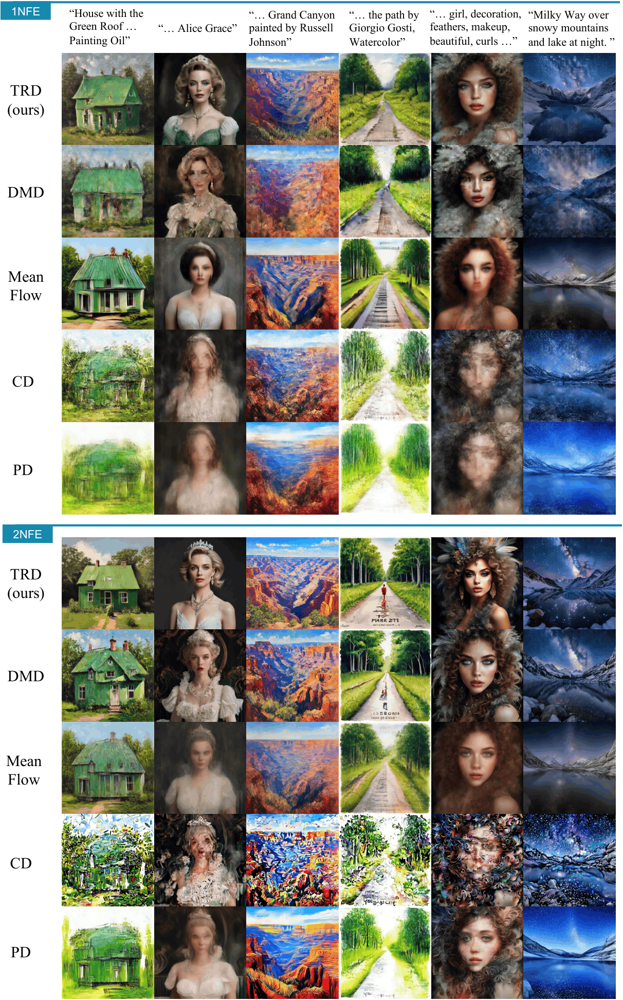

# Trajectory-Regularized Distribution Distillation (TRD)



Official implementation of **"Trajectory-Regularized Distribution Distillation for One-Step Generation."**

> 📄 **Paper:** Coming soon.

## ✨ Highlights

- Concise TRD implementations for both [SANA 1.6B](https://huggingface.co/Efficient-Large-Model/Sana_1600M_1024px_BF16_diffusers) and [Stable Diffusion 3.5 Medium](https://huggingface.co/stabilityai/stable-diffusion-3.5-medium).
- Research-oriented code designed for secondary development, scientific research, and use as an algorithmic reference for other flow-matching models.
- LoRA-based training with lightweight ArcFlow output heads.
- Multi-GPU training and inference, plus a unified image-generation evaluation suite.

## 🧩 Repository Structure

```text
.
├── sana/
│   ├── sana_arcflow.py             # SANA ArcFlow model and pipeline
│   ├── train_sana_trd.sh           # SANA training launcher
│   ├── infer_sana_trd.sh           # SANA inference launcher
│   └── scripts/
│       ├── train_sana_trd.py
│       └── infer_sana_trd.py
├── sd3_5/
│   ├── sd3_arcflow.py              # SD3.5 ArcFlow model and pipeline
│   ├── train_sd3_trd.sh            # SD3.5 Medium training launcher
│   ├── infer_sd3_trd.sh            # SD3.5 Medium inference launcher
│   └── scripts/
│       ├── train_sd3_trd.py
│       └── infer_sd3_trd.py
├── calc_metrics/
│   ├── README.md                    # Evaluation setup and input format
│   ├── calculate_metrics.sh         # Multi-GPU evaluation launcher
│   ├── calculate_metrics.py
│   └── utils/
├── pics/                            # Documentation assets
├── requirements.txt
└── README.md
```

## ⚙️ Environment Setup

We recommend a fresh Conda environment with Python 3.11:

```bash
conda create -n trd python=3.11 -y
conda activate trd
```

Install the PyTorch build appropriate for your CUDA version by following the [official installation guide](https://pytorch.org/get-started/previous-versions/):

```bash
# Example only. Choose the command that matches your CUDA version.
pip install torch==2.12.0 torchvision==0.27.0 --index-url https://download.pytorch.org/whl/cu130
```

The training code requires a recent development version of `diffusers`, so install it from source:

```bash
git clone https://github.com/huggingface/diffusers.git
pip install -e ./diffusers
pip install -r requirements.txt
```

Stable Diffusion 3.5 Medium is a gated model. Accept its license on Hugging Face and authenticate with `huggingface-cli login` before using the SD3.5 scripts.

## 📦 Data Preparation

Training is prompt-only; no training images are required. The default launchers use prompts from **LAION-Aesthetic-6.5+**.

Download `labels_cleaned_train.tsv`(~107M) and `labels_cleaned_test_10k.tsv`(~3M) from [here](https://drive.google.com/drive/folders/1VJd6eOeAVL0uX80fGZ-2fvCsGRa788pN?usp=sharing) and place them under:

```text
datasets/
├── labels_cleaned_train.tsv
└── labels_cleaned_test_10k.tsv
```

## 🚀 Training

Run launchers from the repository root:

```bash
# SANA 1.6B
bash sana/train_sana_trd.sh

# Stable Diffusion 3.5 Medium
bash sd3_5/train_sd3_trd.sh
```

The launcher bash scripts contain default hyperparameters. You can freely adjust the model, data, output, #GPU, and training settings for your environment.

Checkpoints are written to `OUTPUT_DIR/checkpoint-N/`. A complete inference checkpoint includes `pytorch_lora_weights.safetensors` and `arcflow_output_heads.pt`. The inference scripts accept either a specific `checkpoint-N` directory or an output directory containing checkpoints.

## 🖼️ Inference

Set `CHECKPOINT_DIR`, `PROMPT_DATABASE`, and `SAVE_DIR` in the corresponding launcher, then run:

```bash
# SANA 1.6B
bash sana/infer_sana_trd.sh

# Stable Diffusion 3.5 Medium
bash sd3_5/infer_sd3_trd.sh
```

Both launchers randomly select up to `num_gen_pics` prompts using `dataset_seed` and generate `num_images_per_prompt` images for each prompt. Their output has the following flat structure:

```text
<SAVE_DIR>/
├── 000000.jpg
├── 000001.jpg
├── 000002.jpg
├── ...
└── prompts.json
```

`prompts.json` maps every image filename to the exact prompt used to generate it:

```json
{
  "000000.jpg": "a cinematic photograph of a lighthouse at sunset",
  "000001.jpg": "a cinematic photograph of a lighthouse at sunset",
  ...
}
```

The generated directory can be used directly as the student input to the evaluation scripts.

## 📊 Evaluation

The metric stack uses dependency versions that may conflict with the training environment. We recommend a separate Python 3.10 environment:

```bash
conda create -n trd_eval python=3.10 -y
conda activate trd_eval
```

Install the PyTorch build appropriate for your CUDA version by following the [official installation guide](https://pytorch.org/get-started/previous-versions/):

```bash
# Example only. Choose the command that matches your CUDA version.
pip install torch==2.12.0 torchvision==0.27.0 --index-url https://download.pytorch.org/whl/cu130
```

Install other dependencies:

```bash
pip install numpy scipy pillow tqdm torchvision
pip install image-reward
pip install git+https://github.com/openai/CLIP.git
pip install transformers==4.37.2
pip install huggingface_hub==0.23.0
```

Configure the model cache, teacher samples, student samples, and prompt JSON paths at the top of `calc_metrics/calculate_metrics.sh`, then run:

```bash
bash calc_metrics/calculate_metrics.sh
```

Missing metric models are downloaded automatically on the first run and cached under `METRICS_MODEL_ROOT`.

See [`calc_metrics/README.md`](calc_metrics/README.md) for the exact input layout, supported formats, and metric definitions.

## 🏆 Results

### Sample Comparison



## 📚 Citation

If you find this repository useful, please consider citing our work. Citation
information will be added with the paper release.

## 🙏 Acknowledgements

This repository builds on the excellent open-source
[Hugging Face diffusers](https://github.com/huggingface/diffusers) project. We
thank its authors and contributors.
